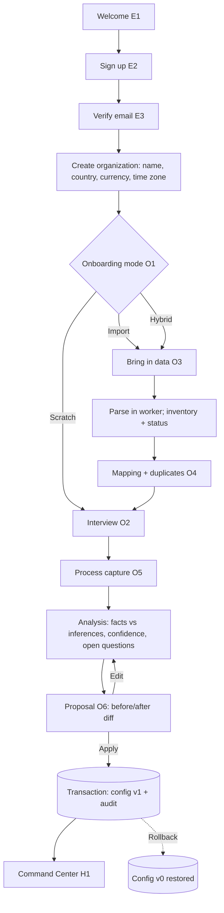
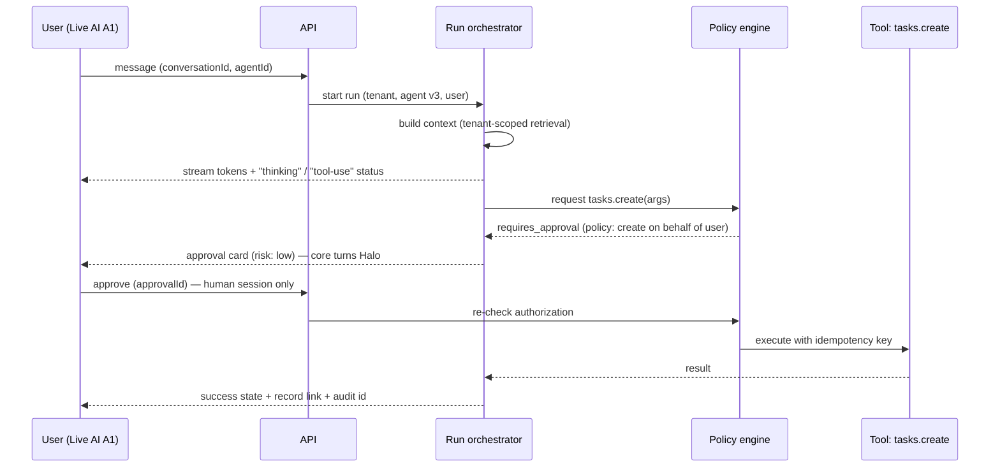

# 02 — Screen Inventory, Navigation and User Flows

## 1. Navigation model

### Mobile (portrait-first)

```
┌──────────────────────────────────────┐
│ [Workspace ▾]        [⌕] [◔ 3] [●]   │  top bar: workspace switcher · search · approvals badge · avatar → More
│                                      │
│              screen body             │
│                                      │
│ [+] quick create (contextual FAB)    │
├──────────────────────────────────────┤
│  Home   Work   ( ◉ )   Business  Library │  bottom nav; centre = Live AI core button
└──────────────────────────────────────┘
```

- There are **5 bottom destinations**: Home (Command Center), Work, **Live AI** (the centre, a raised "core" button that shows the active agent's colour), Business (CRM / Inbox / Calendar / Finance / Growth hub) and Library.
- **More** (settings, members, integrations, automations, audit, security) opens from the avatar. Approvals are never hidden: they appear as a top-bar badge, in a Home section and as a deep link (`qline://approvals/:id`).
- The **workspace switcher** is always visible top-left and shows the org name and colour chip. Switching workspaces clears in-memory caches.
- The Business hub only shows the modules the organization enabled during onboarding. Disabled modules show under "Add a module", never as fake tiles.
- The **keyboard-safe composer** in Live AI and record comments resizes with the keyboard insets.

Why bottom navigation here (when Chrono uses a drawer): Qline has 5 peer destinations that are used daily, and the spec's §4 suggests bottom navigation. Chrono's drawer suited a single-thread chat app. The Live AI centre button keeps the signature experience one tap away.

### Web (≥ 1024 px)

The left sidebar holds Home, Live AI, Work, Business (expandable), Library and Automations, with Settings at the bottom. The org switcher sits at the top of the sidebar. The page gets a multi-panel layout: list | detail | agent panel. Global search opens with ⌘K / Ctrl K. 600–1023 px uses a collapsed icon rail.

## 2. Screen inventory

The ID prefix shows the area. The P column is the build phase (see 11). ✦ marks a screen that is in the interactive prototype.

### Entry and onboarding
| ID | Screen | Purpose / primary action | States | P |
| --- | --- | --- | --- | --- |
| E1 ✦ | Welcome | Explain value; **Get started** | first launch, returning (skip to sign-in) | 1 |
| E2 ✦ | Sign in / Sign up | Email + password, Google; **Sign in** | invalid, locked, verify-email pending, offline | 1 |
| E3 | Verify email / Reset password | Enter code / set password | expired code, resend cooldown | 1 |
| O1 ✦ | Onboarding mode | Scratch / Import / **Hybrid (recommended)** | — | 2 |
| O2 ✦ | Business interview | Conversational Q&A with structured chips; **Next** | skip/unknown, low-confidence flag | 2 |
| O3 ✦ | Bring in data | Upload files, connect Drive; file inventory with parse status | uploading, parsing, failed (reason), unsupported type | 2 |
| O4 ✦ | Import mapping | Column → field mapping, duplicates; **Confirm mapping** | conflicts, partial errors | 2 |
| O5 | Process capture | Describe process → workflow draft with "missing details" | contradictions flagged | 2 |
| O6 ✦ | Workspace proposal | Before/after diff by category; **Apply configuration** | partially accepted, apply in progress, apply failed (rolled back) | 2 |
| O7 | Configuration history | Versions list; **Roll back** | confirm dialog, rollback running | 2 |

### Core
| ID | Screen | Purpose / primary action | States | P |
| --- | --- | --- | --- | --- |
| H1 ✦ | Command Center | Briefing, priorities, approvals, metrics (only if data); quick create | empty (guide to import), loading skeleton, stale data badge, offline | 3 |
| H2 | Metric drill-down | Underlying records for a KPI | filter, empty | 3 |
| A1 ✦ | Live AI | Agent core, transcript, composer, tool timeline | idle, listening, thinking, tool-use, awaiting approval, speaking, success, error, offline, mic denied | 4 |
| A2 | Conversation history | Search conversations | empty | 4 |
| A3 ✦ | AI Workforce | Agent roster with status | template not set up, paused, error | 4 |
| A4 ✦ | Agent profile | Overview, memory scope, permissions, runs | editing, version diff | 4 |
| A5 | Agent run detail | Steps, tool calls, inputs/outputs, cost | failed step, retried | 4 |
| P1 ✦ | Approval center | Queue with risk and requester | empty ("Nothing waiting"), expired | 4 |
| P2 ✦ | Approval detail | Preview, reason, risk; **Approve** / Edit / Reject | approving, approved, failed after approval | 4 |
| W1 ✦ | Work — Tasks | List/board, filters, quick add | empty, offline (cached), overdue | 3 |
| W2 | Project detail | Milestones, tasks, members, activity | — | 3 |
| W3 | Task detail | Fields, subtasks, comments, attachments | agent-proposed (needs acceptance) | 3 |

### Business hub
| ID | Screen | P |
| --- | --- | --- |
| B0 ✦ | Business hub (enabled modules + "Add a module") | 3 |
| B1 ✦ | CRM — contacts/clients list (imported) → pipeline later | 3 / 6 |
| B2 | Client detail with timeline | 6 |
| B3 | Inbox (Gmail) — "Not connected" state until Phase 6 | 6 |
| B4 | Calendar — agenda/day/week | 6 |
| B5 | Finance overview, transactions | 7 |
| B6 | Growth Studio — content calendar, campaigns | 7 |

### Library, automation, admin
| ID | Screen | P |
| --- | --- | --- |
| L1 ✦ | Library — documents and memory with provenance | 3 |
| L2 | Document detail / parse status / versions | 3 |
| L3 | Memory record detail — source, confidence, supersede | 3 |
| F1 ✦ | Automation Studio — workflow viewer (mobile) | 5 |
| F2 | Workflow run history + logs | 5 |
| F3 | Web workflow editor (canvas) | 5 |
| I1 ✦ | Integrations hub — truthful states | 2 |
| I2 | Connector detail — scopes, agents allowed, last sync, test | 2 |
| S1 ✦ | Settings & security | 1 |
| S2 | Members & roles | 1 |
| S3 | AI providers & budgets | 4 |
| S4 | Audit log | 1 |
| S5 | Sessions & devices | 1 |
| S6 | Data export / delete org | 1 |
| X1 ✦ | Workspace switcher (sheet) | 1 |
| X2 | Global search | 3 |
| X3 | Notifications | 4 |

The web companion has every screen above, plus these: data tables with saved views (CRM/Work), the import mapping workbench, the workflow canvas editor, member admin, the agent run inspector and the org audit explorer.

## 3. Primary flows

### J1–J5 Onboarding (Hybrid)



### J7 Ask an agent and approve an action



### J8 Workflow with an approval gate

Trigger `crm.lead.created` → condition `lead.score ≥ threshold` → Research agent summary → Sales agent draft → **approval node** → action (MVP: record the activity internally; external send is Phase 6) → failure path: log and notify the owner.

## 4. Deep links

`qline://o/:org/approvals/:id`, `qline://o/:org/tasks/:id`, `qline://o/:org/agents/:agent/conversations/:id`, `qline://o/:org/records/:type/:id`. A deep link to another org than the active one asks before switching, and the server still authorizes the request.
