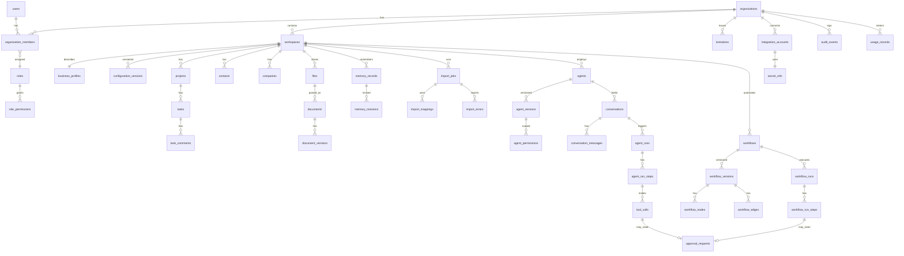

# 05 — Data Model, ERD and Tenant Isolation

## 1. Conventions

- IDs: UUIDv7 (`uuid` columns). They sort by time and are safe to expose.
- Every tenant-owned table has `org_id uuid not null` (and `workspace_id` where scoped), `created_at`, `updated_at`, `created_by` (user or agent ref) and `deleted_at` for soft delete where recovery matters.
- Composite indexes start with `org_id` (for example `(org_id, workspace_id, status, due_at)`).
- Foreign keys that cross tenant-owned tables are **composite** (`(org_id, id)`), so a row cannot reference another org's row, even by mistake.
- Money: `amount_minor bigint` + `currency char(3)`. There are no floats.
- Provenance columns on business facts: `source_kind` (`user|import|connector|agent_inferred`), `source_ref`, `confidence numeric(3,2)`, `status` (`active|outdated|superseded`).

## 2. ERD (MVP core; later modules summarised)

The master prompt's §8 full entity list is adopted as written. These tables arrive in later phases and follow the same conventions: **CRM** (`clients, leads, opportunities, pipeline_stages, interactions, notes`), **comms/calendar** (`connected_accounts, communication_channels, message_threads, messages, calendar_connections, calendar_events`), **finance** (`financial_accounts` metadata only, `transactions, transaction_categories, budgets, invoices, financial_reports`), **growth** (`social_accounts, campaigns, content_items, content_assets, publishing_jobs, campaign_metrics, partnerships`) and **platform** (`notifications, security_events, webhook_subscriptions, model_providers, model_configs, tool_definitions, departments, teams, business_goals, business_metrics, custom_fields, tags, attachments, activity_events, task_dependencies, project_members, milestones`).

## 3. Key tables (MVP detail)

| Table | Notable columns |
| --- | --- |
| `organization_members` | `org_id, user_id, role_id, status(active|suspended), joined_at` · unique `(org_id,user_id)` |
| `roles` / `role_permissions` | System roles Owner/Admin/Manager/Member/Viewer seeded per org; `permission` strings like `tasks.create`, `agents.manage`, `approvals.decide:high` |
| `configuration_versions` | `workspace_id, version int, parent_version, snapshot jsonb, diff jsonb, status(proposed|applied|rolled_back), applied_by, applied_at` |
| `memory_records` | `scope(workspace|agent:<id>|project:<id>)`, `kind(fact|preference|policy|context)`, `content`, provenance columns, `owner_id`, `expires_at` |
| `agent_versions` | `agent_id, version, instructions, model_config_id, memory_scopes text[], tool_allowlist text[], approval_policy jsonb, budgets jsonb` (immutable once used) |
| `agent_runs` | `org_id, agent_version_id, initiated_by_user, trigger(chat|workflow|delegation), status, model, input_tokens, output_tokens, cost_minor, started_at, ended_at, error` |
| `tool_calls` | `run_step_id, tool, args jsonb (redacted copy), policy_decision(allow|require_approval|deny), idempotency_key unique, result_summary, status` |
| `approval_requests` | `org_id, requester_kind(agent|workflow), requester_id, action, target_ref, preview jsonb, risk(low|medium|high), reason, status(pending|approved|rejected|expired|executed|failed), decided_by_user, decided_at, expires_at` · `decided_by_user` must be a human session (DB check + service rule) |
| `audit_events` | `org_id, actor_kind(user|agent|system), actor_id, action, target_ref, outcome, correlation_id, ip_hash, at, prev_hash, hash` (hash chain: tamper-evident) |
| `secret_refs` | `org_id, provider, ciphertext, dek_wrapped, kms_key_id, scopes text[], rotated_at`. Never returned by any API. |
| `import_jobs` | `file_id, detected_entity, status, rows_total/ok/skipped/failed, idempotency_key, mapping_id` |

## 4. Tenant isolation plan (defence in depth)

1. **Application layer (primary).** The `TenantContext` is required by every repository function, and Drizzle query builders are wrapped so that `org_id = ctx.orgId` is always applied. A lint rule bans importing raw `db` outside `packages/schema/repo`.
2. **Database layer (backstop).** PostgreSQL **row-level security** is on for every tenant table: `USING (org_id = current_setting('qline.org_id')::uuid)`. The API sets `SET LOCAL qline.org_id` per transaction. The app connects as a **non-owner, least-privilege role**, so RLS cannot be bypassed. Migrations run as a separate owner role.
3. **Composite foreign keys** prevent cross-tenant references.
4. **Storage.** Object keys are `org/<org_id>/ws/<ws_id>/<file_id>`. Signed URLs are issued only after an authorization check and last at most 5 minutes.
5. **Search and retrieval.** The `org_id` filter is applied inside the SQL. Retrieval for agents also intersects with the agent's `memory_scopes`.
6. **Caches and realtime.** Cache keys are prefixed with `org_id`. Realtime channels are `org:<id>:user:<id>` and are authorized on subscribe.
7. **Jobs.** Each payload carries `org_id` and the initiating user. The worker sets the RLS context and re-checks permission before acting.
8. **Tests.** A generated **isolation suite** creates orgs A and B and, for every resource family and endpoint, asserts that B cannot list, read, update, delete or reference A's rows (→ 404, never 403, so existence is not leaked). It runs in CI as a required check.

## 5. Migration strategy

Drizzle Kit migrations are SQL-reviewed in PRs, and changes are **expand → migrate → contract** so older mobile builds keep working. The API is versioned (`/v1`) and mobile sends `X-Qline-Client` with its build number, so the server can return `426 Upgrade Required` for builds it no longer supports.
