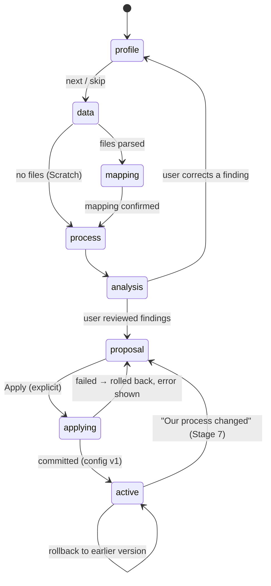

# 08 — Onboarding, Import Pipeline and Workflow Execution

## 1. Adaptive onboarding state machine



- The session is saved after every answer, so the user can resume on another device.
- **Question budget:** at most 12 core profile questions. Each one is tagged with the configuration fields it affects, and a question is skipped if those fields are already known from imports.
- Each answer is stored with `source_kind=user`, a timestamp and a confidence. "I don't know" is a valid answer and creates an open question instead of a guess.
- **Analysis output** is a structured `BusinessModel` JSON (business type, functions, offerings, client types, roles, processes, metrics, tools). Every field has `{value, source, confidence, evidenceRefs[]}`. Items below 0.6 confidence are shown as "Please confirm".
- **Proposal** = `ConfigDiff` grouped as modules, terminology, fields, pipeline stages, task statuses, roles, agents (with tool permissions), workflows (always created **disabled**), knowledge folders, notifications, suggested integrations (with their required scopes) and the data import plan.
- **Apply** runs in one DB transaction for the config tables. Bulk record imports, if any, run as separate idempotent jobs linked to the version. Rollback restores the config snapshot and leaves user-created records in place, listing them for the user. **No external side effects are activated by applying.**

## 2. Import pipeline

```
upload (signed, resumable) → validate (ext + MIME + magic bytes + size) → [malware scan if available]
→ store private original → parse in sandboxed worker (CPU/mem/time limits, no network)
→ detect entity & schema → preview + mapping UI → duplicate/conflict detection
→ user picks merge | skip | create-new (per rule or per row) → validate rows
→ import in bounded transactions (500 rows) with idempotency key per row hash
→ report: ok / skipped / failed with downloadable error CSV → provenance stored → optional rollback
```

| Format | MVP parser (Node worker) | Notes |
| --- | --- | --- |
| CSV | streaming parser | Delimiter and encoding detection |
| XLSX | SheetJS CE or exceljs (decide on licence + size review) | Values only; **formulas evaluated never, macros never** (XLSM rejected) |
| PDF | pdf text extraction | Text layer only in the MVP; scanned PDFs flagged "needs OCR (planned)" |
| DOCX | mammoth-style text extraction | Embedded objects ignored |
| TXT / Markdown / JSON | native | JSON depth and size limits |
| Images | stored, not parsed in the MVP | Vision parsing is planned and needs the user's consent for the provider |

Limits (initial): 25 MB per file, 200 MB per import session, 100k rows, archive extraction off (zip support is planned, with zip-bomb ratio checks). File names are sanitized and stored as ids.

Duplicate detection: normalized email/phone/domain exact match, plus fuzzy name match (trigram ≥ 0.85) shown as "Possible duplicate". Nothing merges automatically.

AI-assisted mapping is optional. If AI is disabled or not consented to, the user maps columns manually with heuristic suggestions (header synonyms). Before any document content goes to a third-party AI provider, the user sees which provider and why, and must consent at the org level.

## 3. Workflow execution model

**Definition (versioned JSON):** `nodes[]` (trigger, condition, branch, action, delay, schedule, approval, end) plus `edges[]`. Each action references a tool from the registry and a `secret_ref` id, never a raw secret.

**Lifecycle:** `draft → published (version n) → enabled ⇄ disabled`. Editing a published workflow creates draft n+1, and runs stay pinned to the version they started on.

**Execution (pg-boss worker):**

1. A trigger event arrives (event bus, schedule, manual or webhook with a verified signature). The dedupe key is `(workflow_id, trigger_event_id)`.
2. A `workflow_run` is created (status `running`) and the first step is enqueued.
3. Each step is its own job. It sets the RLS context, re-checks the owner's permissions and runs through the same **policy engine** as agent tools.
4. An approval node creates an `approval_request`, sets the run to `waiting_approval` and exits. The decision event re-enqueues the next step.
5. A delay or schedule node becomes a delayed job.
6. Failure handling: bounded retries (3, exponential backoff with jitter), then the failure path runs, then the job moves to the dead-letter queue and the owner is notified.
7. Compensation: actions declare `compensate?` (for example, delete a created task). Compensations are proposed to the user on failure, not run automatically, for L2+ actions.
8. Loop guard: a maximum of 50 steps per run, and a workflow cannot trigger itself through its own output events within one correlation chain (correlation depth ≤ 3).
9. Concurrency: a per-workflow limit (default 5) and a per-org limit.

**Dry run:** the full execution path runs with the tools in `simulate` mode. They return typed sample results and produce **no side effects**, and the run is labelled "Dry run — nothing was changed".

**MVP template:** "New client imported → Operations agent drafts onboarding tasks → approval → tasks created → owner notified". It uses internal tools only, so it can be tested end-to-end before any external connector exists.
